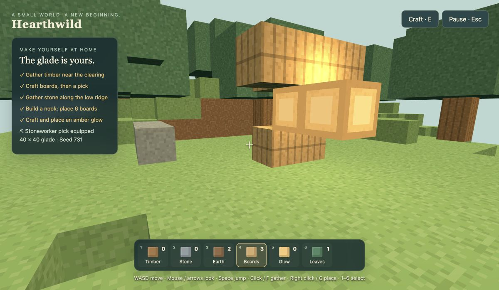

# Hearthwild

An original peaceful voxel sandbox: gather timber, craft boards and a stoneworker pick, gather stone, build a nook, and place amber glow. Original generated pixel textures and synthesized tones; no Mojang assets or branding. Private repository, local browser play, no public deployment.

## Play locally

Requires Node 24 (tested with 24.20.0).

```sh
cd /Users/intrepion/Documents/Codex/2026-10-10/task-3/kata-inspired-by-minecraft-codex-dot
npm ci
npm run dev
```

Open http://127.0.0.1:5175. This project uses strict port 5175 and does not alter the other games on 5173/5174.

WASD move, Shift sprint, Space jump, mouse look after entering with capture. Select **keyboard / drag look** if capture is unavailable. In that mode drag the scene or use arrow keys to look. Left click/F gathers; right click/G places against the targeted face. Number keys 1–6 or scroll select the hotbar. E opens the pack/workbench; Esc pauses. R returns to a clear position without losing resources. Touch devices have a movement pad, gather/place/jump buttons and drag look. Resume after pause uses drag/keyboard look; reload and use Enter for mouse capture again.

Timber boards: 4 timber → 8 boards. Pick: 2 timber + 2 boards → a permanent equipped tool. Amber glow: 2 boards + 1 stone → 2 luminous blocks. The pick unlocks stone gathering. Nearby timber and a low stone ridge support the opening. Craft another board batch as needed. The optional journey recognizes six currently existing player-placed boards and one glow, not an enclosed-house simulation. Build walls and an overhead canopy, then continue freely.

## Actual scope

Seeded 40 × 40 cells, y=0…23; unmineable foundation at y=0. No infinite world, chunks streaming, multiplayer, creatures, hunger or combat. Each mined cell yields one resource; placement spends one. World edges block movement. Gravity and body collision use bounded movement substeps. Exposed faces are merged by material; geometry is rebuilt after edits. At most 12 glow point lights render; extra glow blocks retain emissive textures. Graphics need WebGL. Rendering has no shadows/day-night simulation. A compact peaceful building game, not a Minecraft reproduction.

Saves are local to this browser/origin, version 1, validated as a whole with a previous-valid-save backup. Invalid snapshots start fresh or recover the backup. Safe player positions recover when embedded/out of bounds. Clearing browser storage loses the world; there is no cloud sync. Saves do not include camera orientation, sound or sensitivity settings. Start a fresh glade requires an in-game confirmation.

## Verification

```sh
npm run typecheck
npm test
npm run build
npm audit --audit-level=moderate
```

See [verification](docs/VERIFICATION.md), [acceptance criteria and delegated decisions](docs/SPEC.md), [glossary](GLOSSARY.md), and [architecture decision](docs/adr/0001-finite-world-and-save.md).


